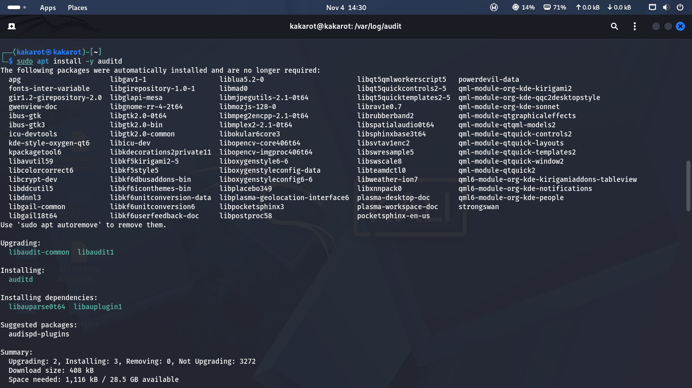
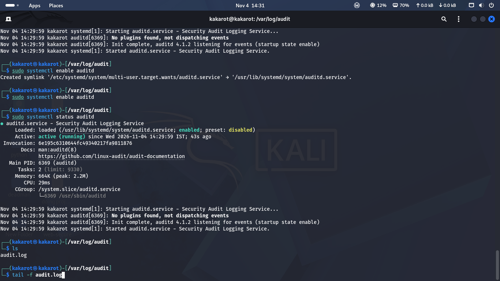
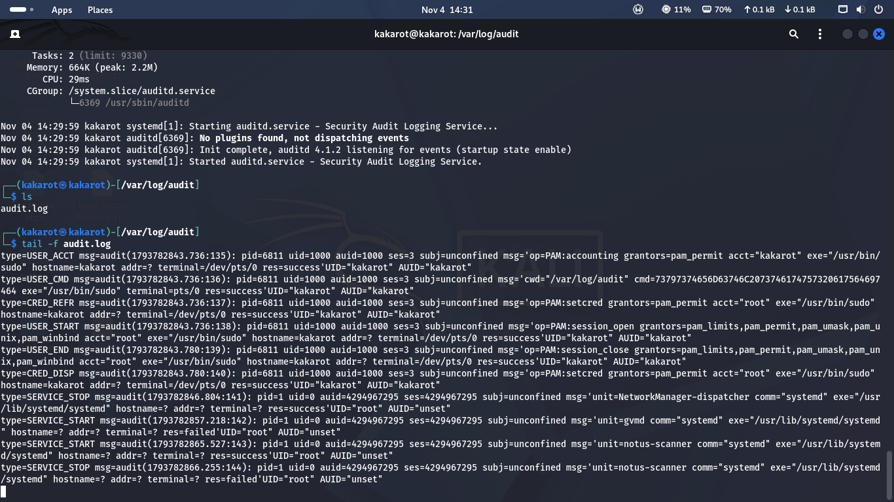
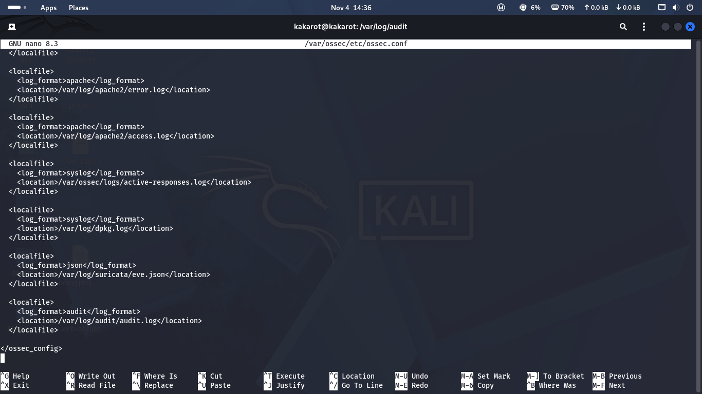
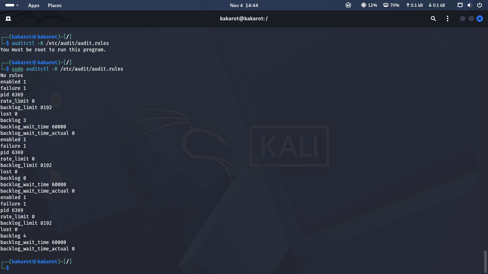
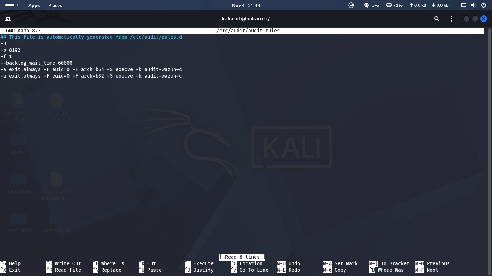
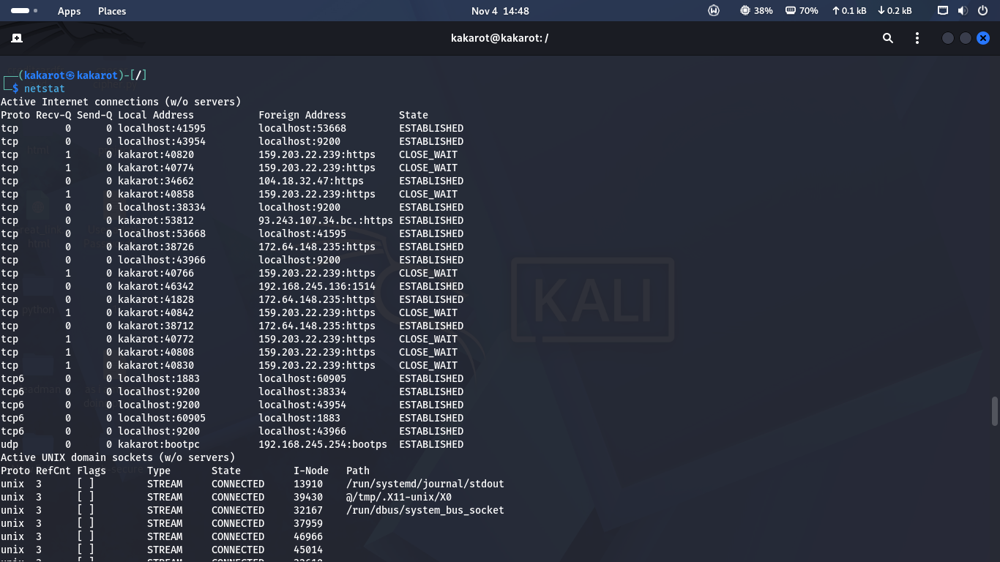
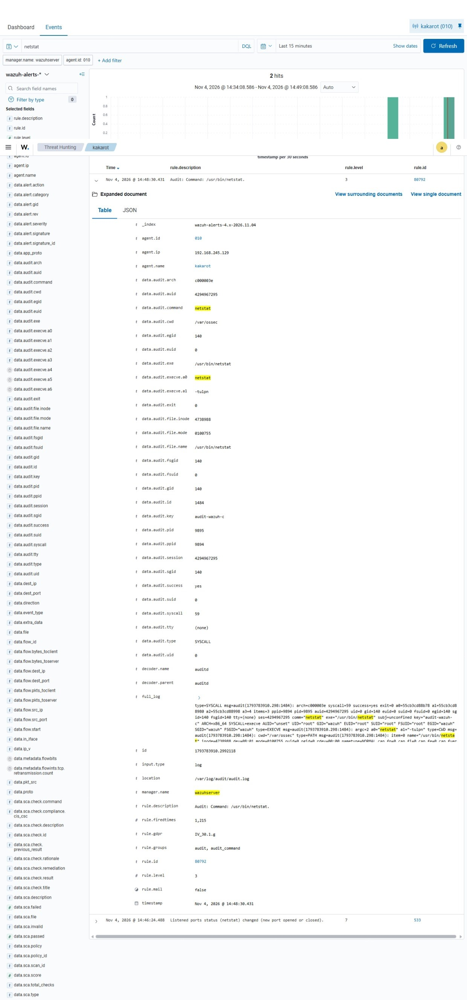
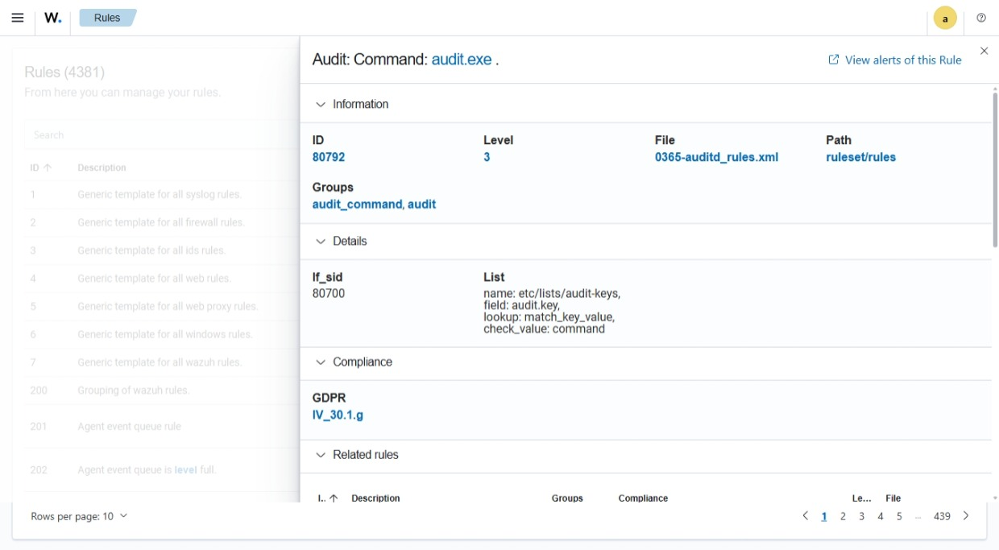
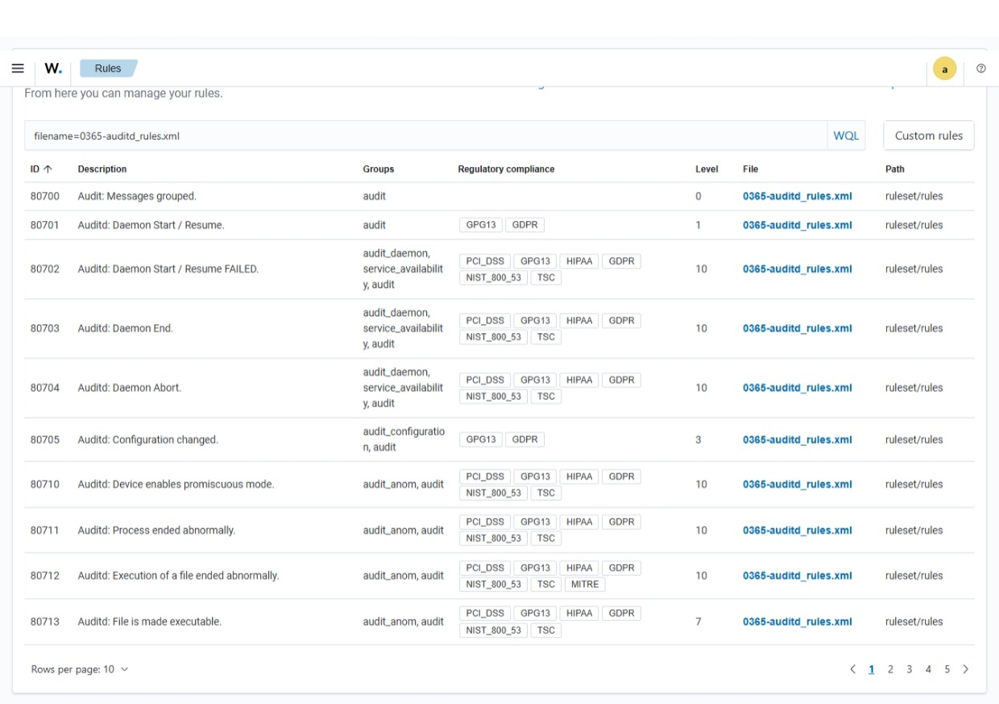

# Linux Command Auditing with auditd and Wazuh

## Overview
This lab installs `auditd`, the Linux Audit daemon, on a Kali Linux endpoint. I load an audit rule that records every program executed with root privileges, forward the audit log to Wazuh, and trace a `netstat` execution from the kernel audit record to a Wazuh alert.

## Lab environment
| Component | Details |
|---|---|
| Endpoint | kakarot, Kali GNU/Linux 2025.1 (Wazuh agent ID 010, IP 192.168.245.129) |
| Audit daemon | auditd 4.1.2 |
| Audit log | `/var/log/audit/audit.log` |
| Rules file | `/etc/audit/audit.rules` (generated from `/etc/audit/rules.d`) |
| SIEM | Wazuh agent v4.8.2, manager `wazuhserver` |
| Wazuh ruleset | `0365-auditd_rules.xml` |

## Objectives
- Install and enable auditd
- Read raw audit records and understand their types
- Load an audit rule that logs command execution
- Forward `audit.log` to Wazuh
- Find the matching alert in the Wazuh dashboard and read its fields

## Steps

### 1. Install auditd
```bash
sudo apt install -y auditd
```
APT installed `auditd` with its dependencies `libauparse0t64` and `libauplugin1`, and upgraded `libaudit-common` and `libaudit1`.



### 2. Enable and start the service
```bash
sudo systemctl enable auditd
sudo systemctl status auditd
```
The service is `enabled` and `active (running)` (auditd 4.1.2, PID 6369, started 14:29:59). The log shows `No plugins found, not dispatching events`, which means no audit event dispatcher plugins are configured. This does not stop the log file from being written. The audit log is created at `/var/log/audit/audit.log`.



### 3. Watch the audit log
```bash
cd /var/log/audit
tail -f audit.log
```
Even with no custom rules, auditd records system events. The log shows these record types:

| Record type | What it means | Example in my log |
|---|---|---|
| USER_ACCT | PAM accounting check | `sudo` accounting for user kakarot |
| USER_CMD | A command run through sudo | `cmd=` field in hex, `cwd=/var/log/audit` |
| CRED_REFR, CRED_DISP | Credentials refreshed and disposed | `sudo` setting up root credentials |
| USER_START, USER_END | PAM session opened and closed | root session for the `sudo` command |
| SERVICE_START, SERVICE_STOP | systemd service changes | NetworkManager-dispatcher stopped, gvmd start failed, notus-scanner started and stopped |

Each record has a timestamp and serial number in `msg=audit(<epoch>:<serial>)`, the user (`uid`, `auid`), the process (`pid`, `exe`), and a result (`res=success` or `res=failed`).



### 4. Create the audit rule
`/etc/audit/audit.rules` contains:

```
-D
-b 8192
-f 1
--backlog_wait_time 60000
-a exit,always -F euid=0 -F arch=b64 -S execve -k audit-wazuh-c
-a exit,always -F euid=0 -F arch=b32 -S execve -k audit-wazuh-c
```

| Line | Meaning |
|---|---|
| `-D` | Delete all existing rules |
| `-b 8192` | Set the kernel backlog buffer to 8192 events |
| `-f 1` | On failure, print a message (0 silent, 1 print, 2 panic) |
| `--backlog_wait_time 60000` | How long to wait when the backlog is full |
| `-a exit,always ... -S execve` | Log every `execve` system call (program execution) when it exits |
| `-F euid=0` | Only for processes with an effective user ID of 0 (root) |
| `-F arch=b64` / `b32` | Cover 64-bit and 32-bit programs |
| `-k audit-wazuh-c` | Tag matching events with this key. Wazuh uses the key to classify the event as a command. |



### 5. Load the rules
```bash
auditctl -R /etc/audit/audit.rules       # fails: must be root
sudo auditctl -R /etc/audit/audit.rules  # works
```
Running `auditctl` without `sudo` returns `You must be root to run this program.` With `sudo`, the rules load and auditctl prints the status: `enabled 1`, `failure 1`, `backlog_limit 8192`, `lost 0`.



### 6. Forward the audit log to Wazuh
I added this block to `/var/ossec/etc/ossec.conf` on the agent:

```xml
<localfile>
  <log_format>audit</log_format>
  <location>/var/log/audit/audit.log</location>
</localfile>
```

The same file already reads Apache logs, `dpkg.log`, and the Suricata `eve.json` log. I restarted the Wazuh agent afterward.



### 7. Run a command
```bash
netstat
```
The command listed active TCP, UDP, and Unix socket connections. One line shows the agent connected to the Wazuh manager at `192.168.245.136:1514`.



### 8. Find the alert in Wazuh
In Threat Hunting, filtered to agent `kakarot` (010), I searched `netstat` over the last 15 minutes. It returned 2 hits.

| Time | Description | Level | Rule |
|---|---|---|---|
| 14:48:30 | Audit: Command: /usr/bin/netstat | 3 | 80792 |
| 14:46:24 | Listened ports status (netstat) changed (new port opened or closed) | 7 | 533 |


### 9. Read the alert fields
Expanding the 80792 alert shows the audit record, decoded into fields:

| Field | Value |
|---|---|
| data.audit.command | netstat |
| data.audit.exe | /usr/bin/netstat |
| data.audit.execve.a0, a1 | netstat, -tulpn |
| data.audit.cwd | /var/ossec |
| data.audit.euid / uid | 0 / 0 |
| data.audit.egid | 140 |
| data.audit.syscall | 59 (execve) |
| data.audit.success | yes |
| data.audit.tty | (none) |
| data.audit.key | audit-wazuh-c |
| decoder | auditd |
| rule.groups | audit, audit_command |
| location | /var/log/audit/audit.log |



### 10. Read the Wazuh rule
Rule 80792 is in `0365-auditd_rules.xml`, level 3, groups `audit_command` and `audit`. It builds on rule 80700 (audit messages grouped) and matches events whose audit key is in the list `etc/lists/audit-keys` with the value `command`. That is why the `audit-wazuh-c` key matters.



### 11. Other auditd rules in Wazuh
| Rule | Description | Level |
|---|---|---|
| 80700 | Audit: Messages grouped | 0 |
| 80701 | Auditd: Daemon Start / Resume | 1 |
| 80702 | Auditd: Daemon Start / Resume FAILED | 10 |
| 80703 | Auditd: Daemon End | 10 |
| 80704 | Auditd: Daemon Abort | 10 |
| 80705 | Auditd: Configuration changed | 3 |
| 80710 | Auditd: Device enables promiscuous mode | 10 |
| 80711 | Auditd: Process ended abnormally | 10 |
| 80712 | Auditd: Execution of a file ended abnormally | 10 |
| 80713 | Auditd: File is made executable | 7 |

Rules 80702 to 80704 mean someone stopped or broke the audit daemon, which an attacker may do to hide activity. They are level 10 for that reason.



## Findings
- auditd records events in the kernel, and Wazuh reads the log and applies rules to it.
- My rule logs only programs run with an effective UID of 0. A command typed by a normal user (UID 1000) does not match it. My `netstat` in step 7 ran as my normal user.
- The 80792 alert at 14:48:30 was not my typed command. The fields show `cwd=/var/ossec`, no TTY, and the argument `-tulpn`. That is the Wazuh agent's own listening-ports check running as root. The 14:46:24 alert (rule 533) comes from the same check.
- This is a useful reminder for alert triage: read the fields (cwd, tty, parent process, arguments) before deciding who or what caused an alert.

## What I learned
- How auditd, `auditctl`, and `audit.rules` fit together, and how to read the rule syntax
- That the audit key (`-k`) connects a kernel rule to a Wazuh rule
- The main audit record types and the fields that identify the user, process, and result
- That a root-only execve rule produces alerts from system and agent activity as well as from administrators
- How to separate a human command from automated activity using `cwd`, `tty`, and `auid`

## Skills gained
- Installing and managing auditd with systemd
- Writing and loading audit rules with `auditctl`
- Reading raw audit records (USER_CMD, SERVICE_START, SYSCALL)
- Forwarding logs to Wazuh with `localfile` and `log_format: audit`
- Investigating alerts in Wazuh Threat Hunting by field values
- Reading Wazuh rule definitions (`if_sid`, lists, groups, compliance mappings)

## Limitations
- The audit rule is root-only (`euid=0`). It misses commands run by normal users, so it is a partial view of activity.
- `auid` is `4294967295` (unset) in the alert because the agent runs as a daemon, not from a login session.
- I did not capture an alert for a command typed with `sudo`. That would show a human-triggered event for comparison.

## Next steps
- Run `sudo whoami` and search Wazuh for `data.audit.command: whoami` to capture a human-triggered root command
- Filter the dashboard with `data.audit.key: audit-wazuh-c` and exclude `cwd: /var/ossec` to remove agent noise
- Add a file watch rule: `-w /etc/passwd -p wa -k audit-wazuh-w`, then edit the file and find the alert
- Query the log locally with `sudo ausearch -k audit-wazuh-c`
- Map detections to MITRE ATT&CK (T1059 Command and Scripting Interpreter)
