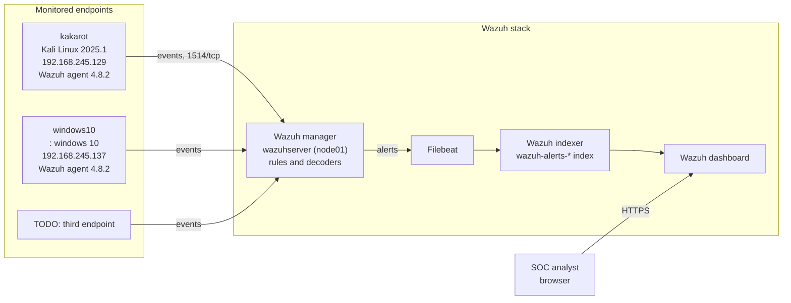

# Home SOC Lab: Multi-Node Wazuh Deployment for Attack Detection and Incident Investigation

A home Security Operations Center (SOC) lab built on Wazuh. The lab collects endpoint telemetry, detects suspicious activity, and documents each investigation as a separate exercise.

## Architecture



### Data flow
1. The Wazuh agent on each endpoint collects logs, file integrity data, and system inventory.
2. The agent sends events to the Wazuh manager (default port 1514/tcp, enrollment on 1515/tcp).
3. The manager decodes each event and matches it against its ruleset. Matches become alerts with a rule ID and severity level.
4. Filebeat ships the alerts to the Wazuh indexer, where they are stored in the `wazuh-alerts-*` index.
5. The analyst opens the Wazuh dashboard to search alerts, review endpoints, and investigate.

## Lab components

| Component | Role | OS / Version | IP address |
|---|---|---|---|
| Wazuh manager (`wazuhserver`, node01) | Receives events, applies rules, generates alerts | TODO | TODO |
| Wazuh indexer | Stores and indexes alerts | TODO | TODO |
| Wazuh dashboard | Web interface for the analyst | TODO | TODO |
| Endpoint: kakarot | Monitored host, agent ID 010 | Kali GNU/Linux 2025.1, agent v4.8.2 | 192.168.245.129 |
| Endpoint: windows10 | Monitored host, agent ID 009 | windows 10 | 192.168.245.137 |
| Endpoint 3 | TODO | TODO | TODO |

## Network
- Virtualization platform: TODO (for example VMware Workstation or VirtualBox)
- Network mode: TODO (for example host-only or NAT)
- Subnet: `192.168.245.0/24` (confirm this matches your setup)

## Exercises

| # | Exercise | Wazuh module | Status |
|---|---|---|---|
| 1 | [File Integrity Monitoring](File-Integrity-Monitoring-Lab/README.md) | Syscheck | Done |
| 2 | TODO | TODO | Planned |
| 3 | TODO | TODO | Planned |

## Skills demonstrated
- Deploying and configuring Wazuh manager, indexer, dashboard, and agents
- Enrolling and troubleshooting agents
- Configuring real-time file integrity monitoring
- Reading and analyzing alerts, rule IDs, and severity levels
- Mapping alerts to compliance controls (PCI DSS, NIST 800-53, GDPR, HIPAA)

## Repository structure
```
.
├── README.md
└── File-Integrity-Monitoring-Lab/
    ├── README.md
    └── screenshots/
```

## Author
Himavanth
M.Sc. Cybersecurity, JSS Science and Technology University, Mysuru
